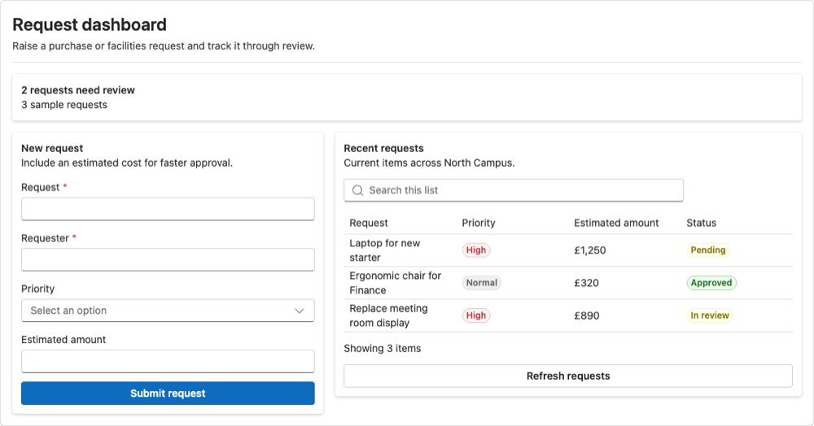
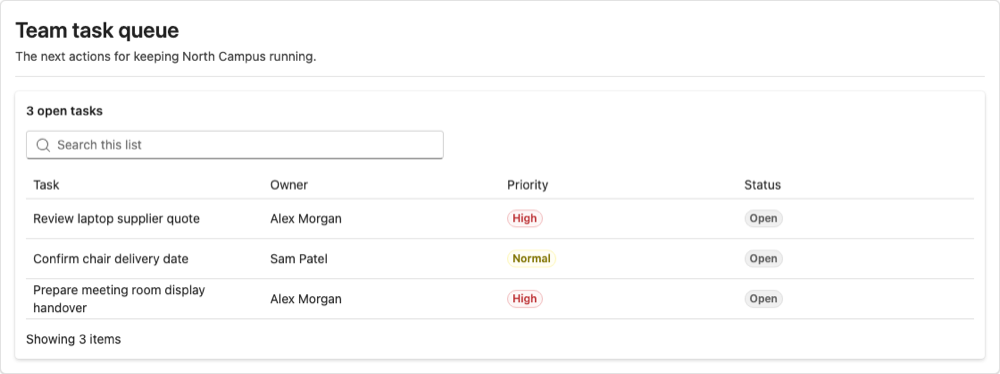

# SPFx Fast

[](https://github.com/vystartasv/spfx-fast/actions/workflows/ci.yml)

Build SPFx apps with authenticated Graph/REST, caching, React hooks, Fluent UI v9 starters, and agent-ready examples.

Targets **SPFx 1.24+**. SPFx supplies authentication; tokens are not stored.

## Preview


One sample combines request intake, tasks, facilities guidance, and approvals. The [screenshot gallery](docs/SCREENSHOTS.md) has more examples, including mobile views.

*Examples are intentionally barebones; use your coding agent's design skill to polish them to your taste.*

<details>
<summary>More examples: requests, tasks, guidance, approvals, and floor plans</summary>

**Request dashboard**



**Team task queue**



**Facilities and IT guide**


**Manager approvals**


**Office floor plan**


</details>

See [authenticated tenant validation results](docs/TENANT-VALIDATION.md) and the [complete screenshot gallery](docs/SCREENSHOTS.md).

Teach your coding agent SPFx Fast before building:

```sh
npx skills add https://github.com/vystartasv/spfx-fast/tree/main/skills/spfx-fast
```

The skill works across supported coding agents. Install the library in your SPFx project with `pnpm add @spfx-fast/core` or `npm install @spfx-fast/core`.

Use npm or pnpm. Examples use pnpm; npm CLI equivalents use `npx --yes --package=@spfx-fast/core -- spfx-fast ...`.

## Start with a working app

List starter ideas:

```sh
pnpm dlx --package @spfx-fast/core spfx-fast use-cases
```

Inspect the site and list first. Generate a dashboard with their IDs:

```sh
pnpm dlx --package @spfx-fast/core spfx-fast dashboard LaptopRequests \
  --site-id 'contoso.sharepoint.com,siteGuid,webGuid' \
  --use-case laptop-request \
  --list-id 'listGuid'
```

The CLI writes React code to `src/spfxFast/`. Match fields to your list before building. Starters use Fluent UI React v9. Ask your coding agent to apply its design skill and SharePoint theme.

Browse [100 app ideas](https://github.com/vystartasv/spfx-fast/blob/main/docs/USE-CASES.md), [24 form presets](https://github.com/vystartasv/spfx-fast/blob/main/docs/SCENARIOS.md), and [54 copyable recipes](https://github.com/vystartasv/spfx-fast/blob/main/docs/EXAMPLES.md).

Common starting points:

| Request | Start with |
|---|---|
| Laptop or purchase request | `laptop-request` |
| IT help desk | `it-help-desk` |
| Employee onboarding | `employee-onboarding` |
| Facility inspection | `facility-inspection` |
| Asset register | `asset-register` |
| Stock reorder tracker | `reorder-workflow` |

Generate any preset with `pnpm dlx --package @spfx-fast/core spfx-fast dashboard <Name> --site-id <inspected-site-id> --use-case <id> --list-id <inspected-list-id>`. For npm, use `npx --yes --package=@spfx-fast/core -- spfx-fast`. Inspect the tenant list and match its fields before building.

See the [agent guide](agent/SKILL.md), [Playwright package](packages/playwright/README.md), and [browser and OCR workflow](docs/AGENT-BROWSER-WORKFLOW.md).

## Use the authenticated client

Create services once per web part:

```ts
import { SPHttpClient } from "@microsoft/sp-http";
import { createSPFxServices } from "@spfx-fast/core/spfx";

const services = await createSPFxServices(
  this.context,
  SPHttpClient.configurations.v1,
);

// services.client: typed Graph. services.sharepoint / services.rest: SharePoint REST.
```

Declare required Graph scopes in the SPFx solution and obtain admin consent. SharePoint still enforces user access.

## What you get

Skip repeated Graph/REST setup, paging, caching, delta sync, and list UI. Start from working code and adapt it to your site.

- **Fast reads:** IndexedDB, cached-first data, background refresh, and list/drive delta sync.
- **React support:** hooks for synced lists, paged list reads, and file content.
- **Private floor plans:** cached image bytes from the signed-in Graph client, accessible location markers, and automatic object URL cleanup.
- **SharePoint coverage:** typed helpers plus authenticated REST access for APIs such as CAML, audience targeting, Search, and `RenderListDataAsStream`.
- **Agent-ready docs:** an API catalog, agent instructions, business app starters, and copyable examples.
- **Fluent UI v9:** generated dashboards use current Fluent UI React components.

See the [API map](https://github.com/vystartasv/spfx-fast/blob/main/docs/API-COVERAGE.md) for typed, raw-only, and unsupported endpoints. [SPFx examples](https://github.com/vystartasv/spfx-fast/blob/main/docs/SPFX-EXAMPLES.md) cover dashboards, HTML, Markdown, and tenant checks.

## Why SPFx Fast?

Microsoft provides authenticated clients; PnP provides broad SharePoint APIs. SPFx Fast adds cached data, delta sync, React hooks, Fluent UI v9 starters, and agent-ready examples.

Use it to reduce setup and give agents working patterns to adapt. Keep PnP or Microsoft libraries where they fit. SPFx Fast accepts their authenticated clients and exposes raw REST/Graph for APIs without typed helpers; it complements those libraries.

Generated screens are a starting point. Ask your agent to refine layout, responsive behavior, states, and SharePoint theme with its design skill.

## Roadmap

**Ready:** authenticated Graph/REST, caching, paging, sync, React hooks, Fluent UI v9 starters, 54 recipes, and 100 app ideas.

**Tenant checks left:** real large lists, service-driven Graph token expiry, and calendar/device behavior.

See the [roadmap](https://github.com/vystartasv/spfx-fast/blob/main/docs/ROADMAP.md) for limits. Local tests do not prove tenant behavior. Flow patterns are guidance; the package does not create or deploy flows.

## Help coding agents use SPFx Fast

If the agent skill is not installed, add it with `npx skills add https://github.com/vystartasv/spfx-fast/tree/main/skills/spfx-fast`. In an SPFx project, install the package and run:

```sh
pnpm dlx --package @spfx-fast/core spfx-fast agent init
```

This adds `SPFX-FAST.md` and links it from `AGENTS.md`. `pnpm dlx --package @spfx-fast/core spfx-fast agent doctor` checks local setup, not tenant permissions or live APIs. For npm, use `npx --yes --package=@spfx-fast/core -- spfx-fast agent doctor`.

For authenticated package deployment, catalog installation, and tenant validation, see the [SPFx app deployment guide](docs/AGENT-SHAREPOINT-DEPLOYMENT.md).

## Install

```sh
pnpm add @spfx-fast/core
```

npm: `npm install @spfx-fast/core`.

React hooks and generated UI use optional peers. Install React 18 and Fluent UI React v9 if your SPFx project lacks them.

## More

- [Roadmap](https://github.com/vystartasv/spfx-fast/blob/main/docs/ROADMAP.md)
- [100 use cases](https://github.com/vystartasv/spfx-fast/blob/main/docs/USE-CASES.md)
- [API coverage](https://github.com/vystartasv/spfx-fast/blob/main/docs/API-COVERAGE.md)
- [Recipes](https://github.com/vystartasv/spfx-fast/blob/main/docs/EXAMPLES.md)
- [SPFx examples](https://github.com/vystartasv/spfx-fast/blob/main/docs/SPFX-EXAMPLES.md)
- [Agent instructions](https://github.com/vystartasv/spfx-fast/blob/main/agent/SKILL.md)
- [Release notes and checks](https://github.com/vystartasv/spfx-fast/blob/main/docs/RELEASE.md)
- [GitHub build and npm publishing](https://github.com/vystartasv/spfx-fast/blob/main/docs/RELEASE.md#publish-from-github)
