# Sample screenshots

Sample browser captures use synthetic North Campus data and an in-memory client. Web parts use Fluent UI v9 web light; approvals use Teams dark. Priority, status, and map areas use distinct semantic colors. The live validation crop below hides the SharePoint site header and shows only the CRUD result.

## Authenticated tenant check

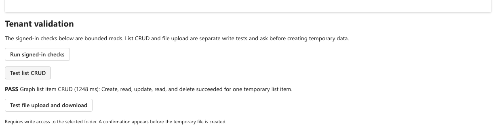

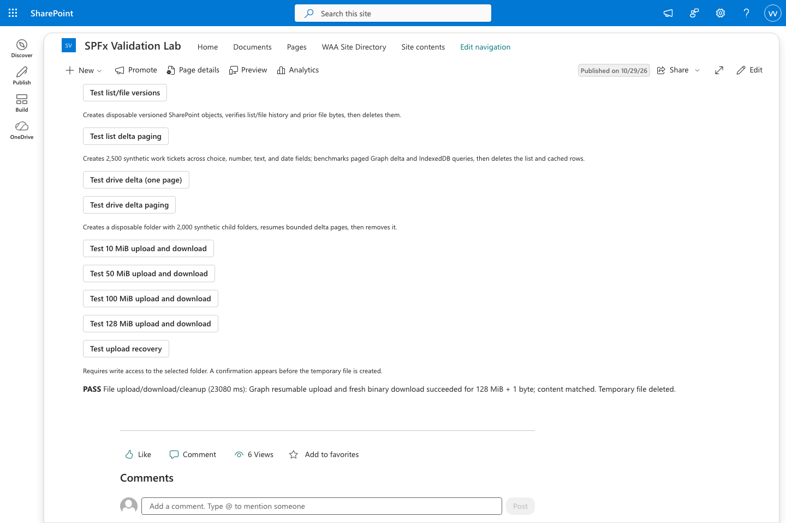

The client recovered after SharePoint committed an upload but the final response was dropped: [result screenshot](assets/screenshots/tenant-upload-final-response-0.2.4.png).

It also recovered when replacing an existing file after the final response was dropped: [replace result](assets/screenshots/tenant-upload-replace-final-response-0.2.4.png).

After the final response was dropped, bounded name probes found Graph's renamed item; every downloaded byte matched: [lost-response rename result](assets/screenshots/tenant-upload-rename-recovery-0.2.4.png). The earlier normal conflict check is [here](assets/screenshots/tenant-upload-rename-conflict.png).

The latest signed-in workload runs created and removed 3,000 synthetic list rows and 3,000 drive folders. List delta synced 15 pages in 4,279 ms after 113,026 ms of creation. Drive delta synced 23 pages in 11,986 ms after 378,049 ms of creation (19 throttled batches). See the [3,000-row list result](assets/screenshots/tenant-delta-3000/list-delta-3000.png), the [3,000-folder drive result](assets/screenshots/tenant-drive-delta-3000/drive-delta-3000.png), the [2,500-row result](assets/screenshots/tenant-delta-2500/list-delta-2500.png), and the [2,000-row list and drive results](assets/screenshots/tenant-delta-2026-10-30/list-delta-2000.png) and [drive](assets/screenshots/tenant-delta-2026-10-30/drive-delta-2000.png). Full results are in the [tenant validation log](TENANT-VALIDATION.md).

The follow-up instrumented run separates folder creation, delta sync, and cleanup: [drive timing result](assets/screenshots/tenant-drive-timing-2026-10-30/drive-delta-2000.png).

The fixture also checks its drive-delta reset path after a synthetic `410`, then reads one page from Graph: [simulated recovery result](assets/screenshots/tenant-drive-410-recovery.png).

## Fluent UI v9 web parts

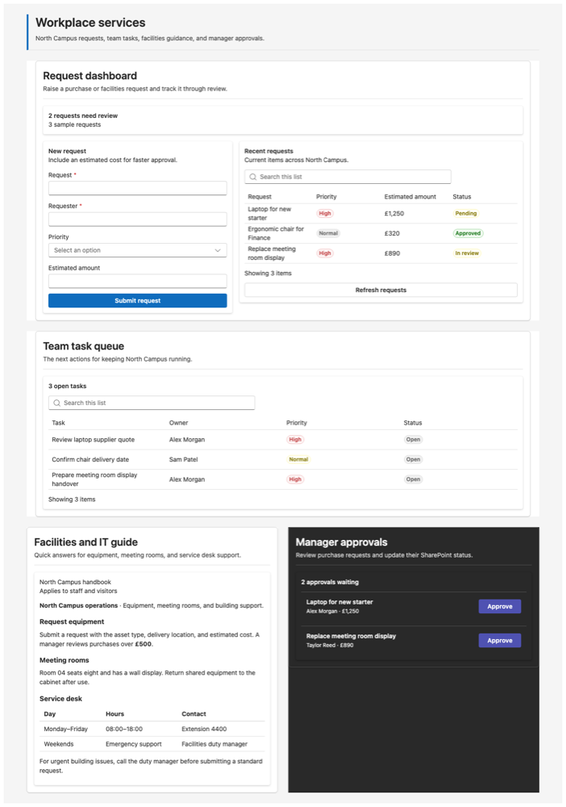

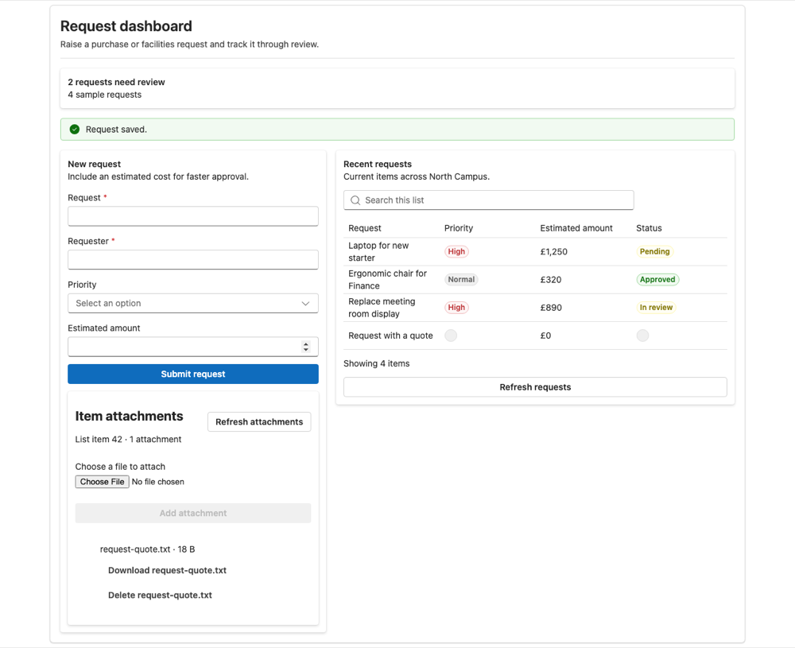

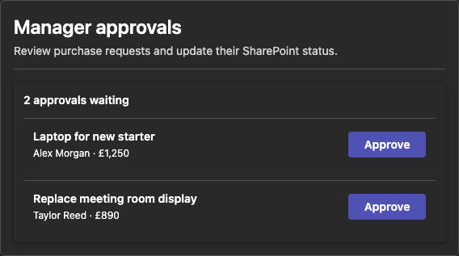

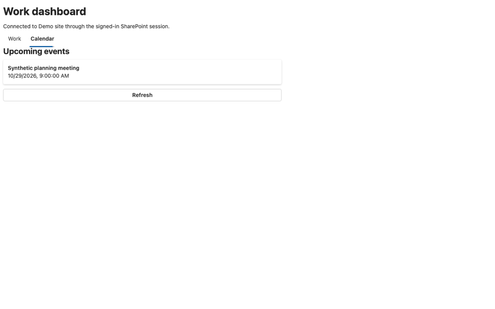

## Other UI

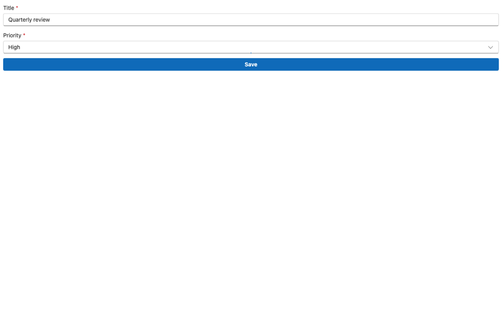

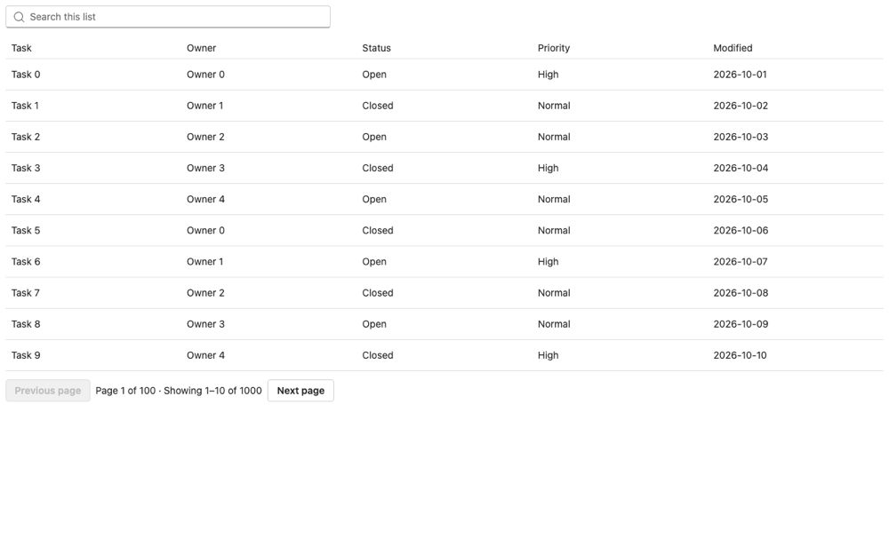

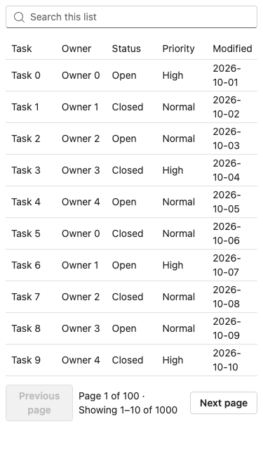

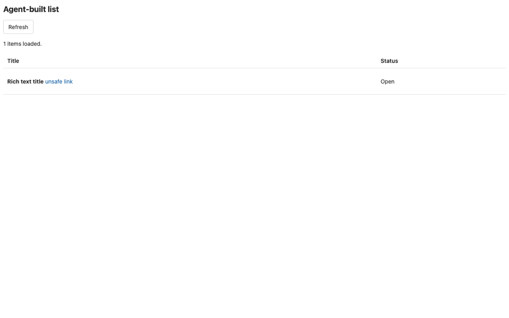

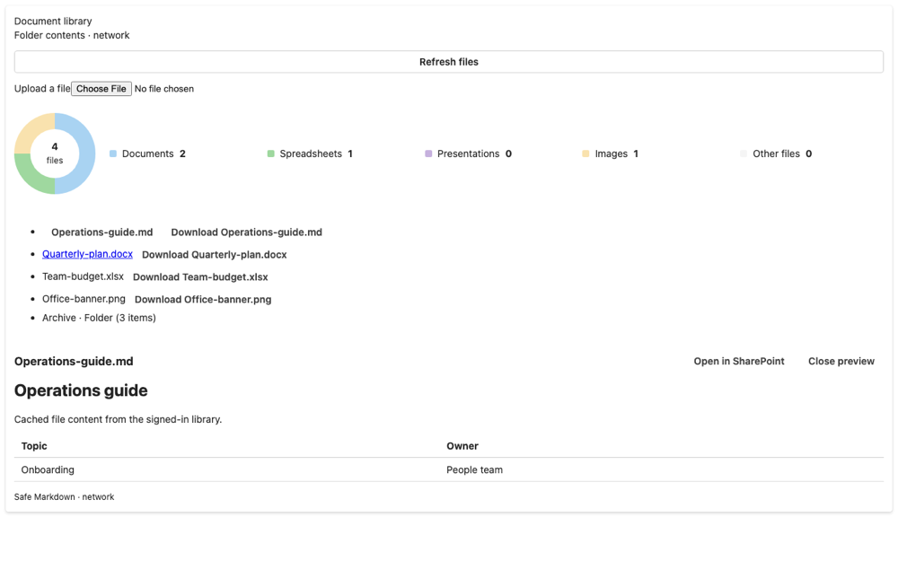

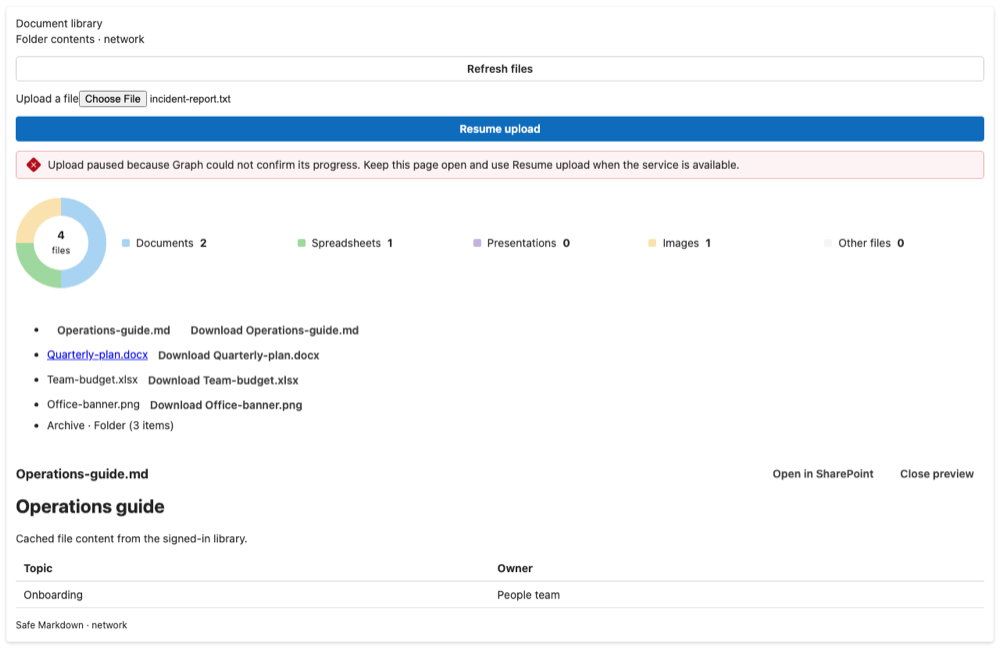

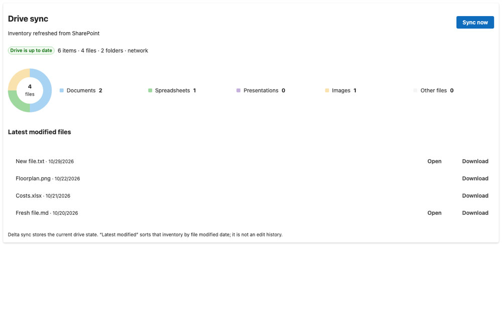

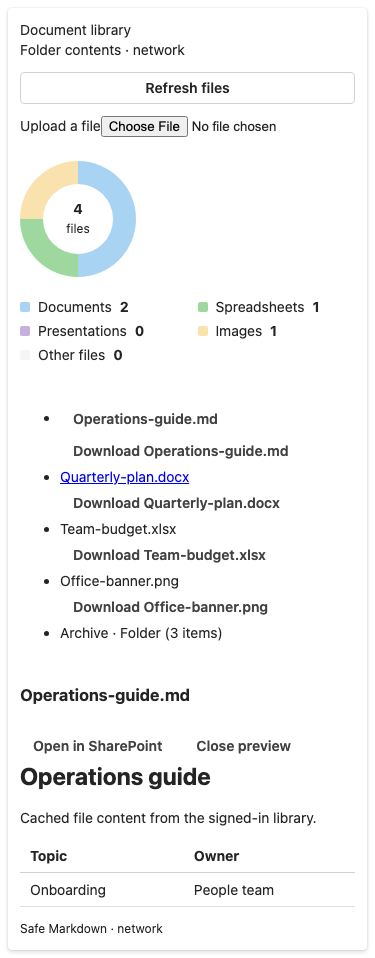

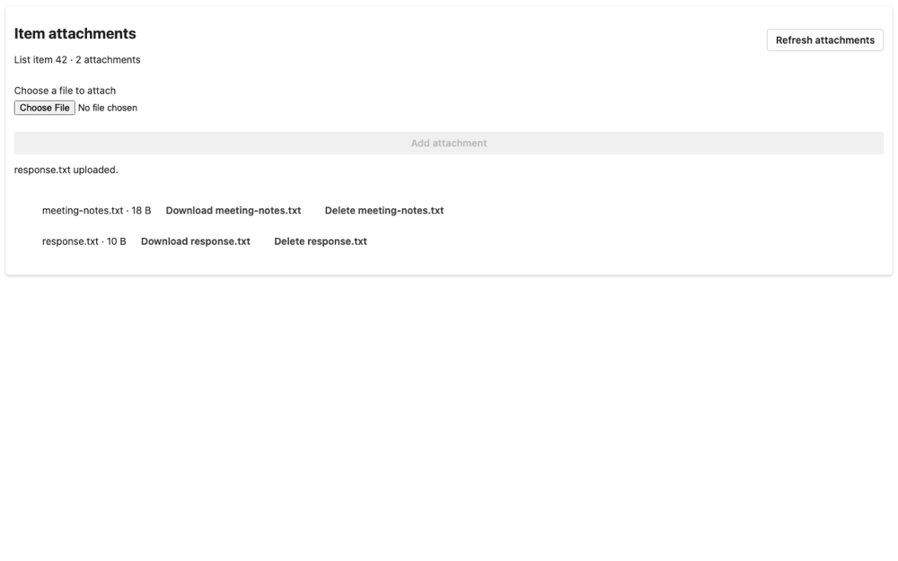

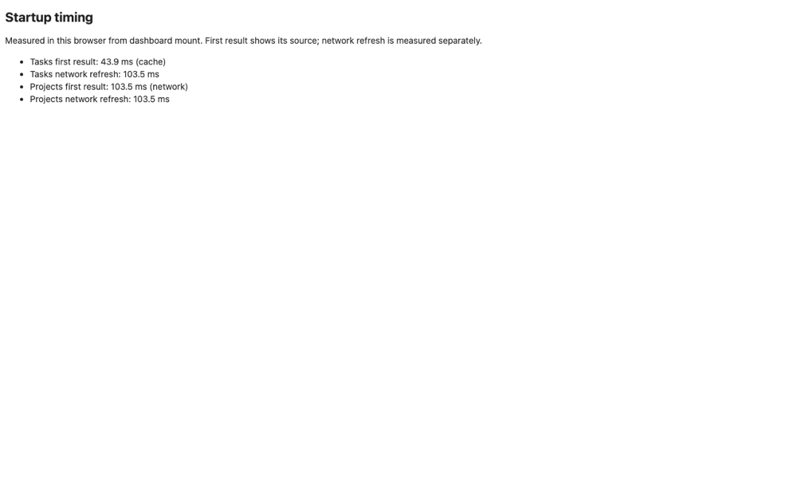

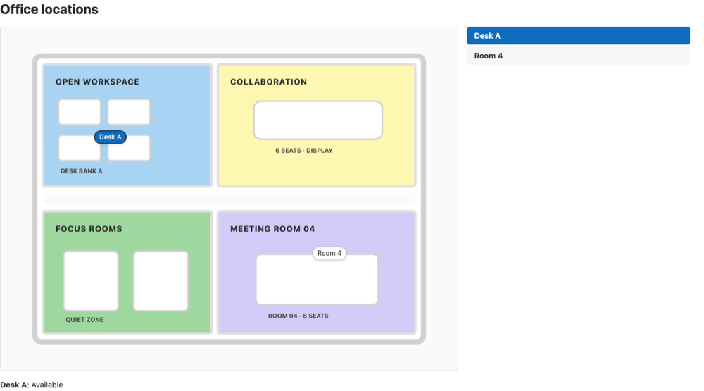

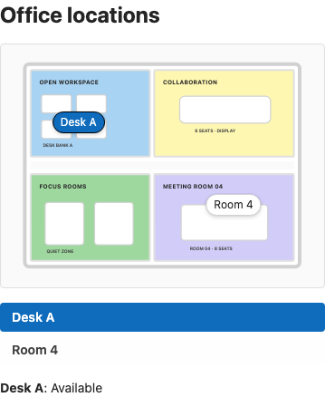

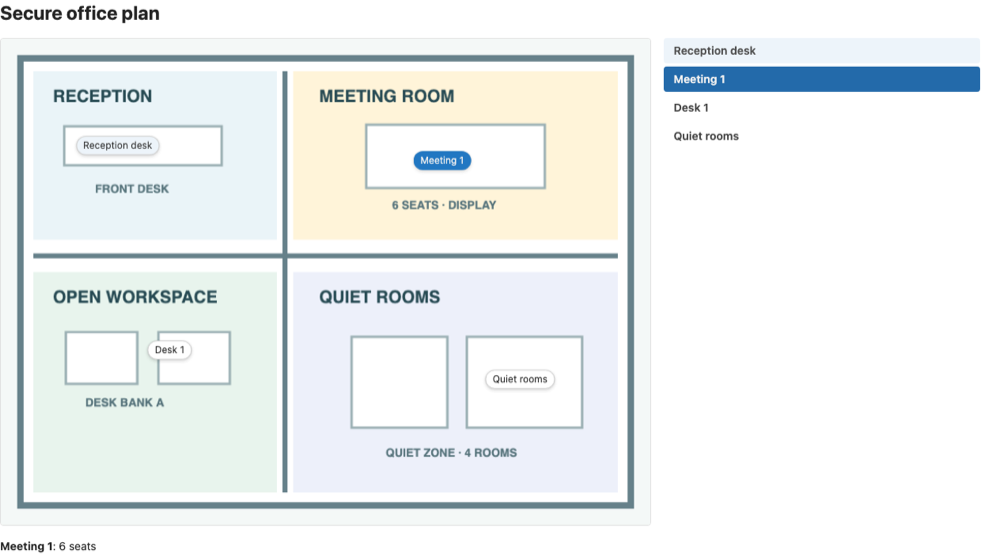

The SPFx 1.24 dashboard was also run in the signed-in SharePoint workbench. Its tenant screenshot stays local; the sample above is safe to publish.
